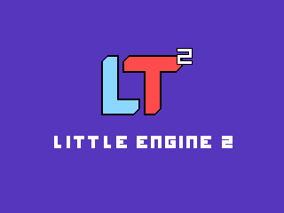
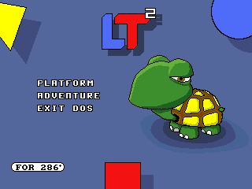
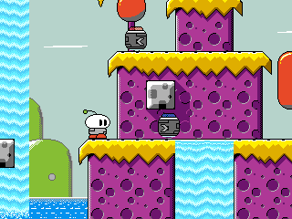
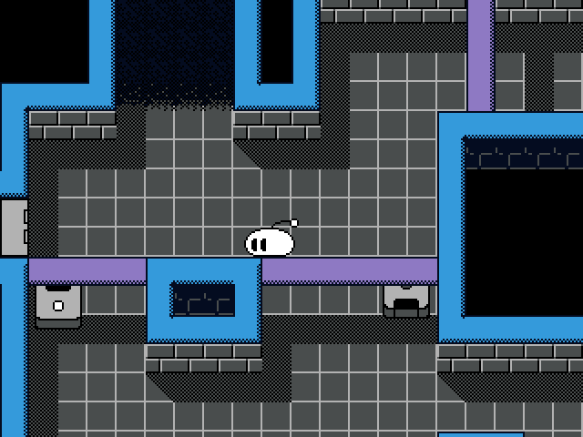

# Little-Engine-2-for-286 VGA
Little Game Engine optimized for VGA and slow 286
----------------------------------------------------------------------------

  

  

The first Little Game Engine is awesome, but it looks a bit "8-Bit" to me, so I wanted to make a simpler but improved version.

It now handles bigger maps with more vertical scrolling, but it only has "platform" and "adventure" modes. 

Also limited to 7 32x32 sprites and requires a 286 CPU. (an 8086 would run it at around 15 fps, and I want 60 fps).

Better sprites: hardware rotate, logical operations and plane masks are now used to accelerate sprite drawing.

The engine only uses VGA 320x240@60Hz 16 color mode.

Added a simple Protracker/MOD player: Mod Master XT ported from pascal to C (using Claude, but most of player code is human and the rest of the engine is 100% human).

The predefined controls are:
- Move player/menus = UP DOWN LEFT RIGHT arrows or joystick.
- Jump in platform levels = D / button 2.
- Show info window in levels = S / button 1.
- choose option in menu = ENTER / button 1.
- Exit stage/game = ESC.

REQUIREMENTS
------------

                  minimum                              recommended

          CPU: 80286/NEC V30 6 MHz            80286/NEC V80 12 MHz
          RAM: 300 Kb                         300 Kb
          GRAPHICS: VGA (256Kb)               VGA (256Kb)
          SOUND: PC Speaker                   Adlib / OPL2 or Sound Blaster 2.0


Little Engine functions:
------------------------

- 320x240 60 FPS MODE, compatible with all cards
- Needs converter to load assest
- Sprites 32x32, 1 64x64 sprite with no background restore function.
- Several modes of hardware colour priority to fake sprites behind objects.
- One 128x128 fixed animation, can only be drawn at 8 pixel boundaries, and can only contain 12 frames.
- TMX maps: Map sizes are fixed 512x36 tiles, created with tiled: https://www.mapeditor.org/
- Graphic print function (8x8 Fonts supporting any encoded language with 1 byte per character).
- Palette animations.
- VGM music for Adlib / OPL2. Protracker MOD for Sound Blaster (no effects, only note off with c00). 


DAT FILES
---------

Engine loads most of the assets from DAT containers. DAT files are a container which stores multiple smaller files.
To generate a DAT file, use `makedat` program (use command line or drag and drop multiple files or a folder).
VGM and MOD files can be loaded without being stored in DAT containers.

Install, Make and Run
---------------

Assuming you use DOSBOX to compile:

* Install the required compiler in drive C:
	```
	Borland Turbo C++ 3.0
	Borland Turbo Assembler 2.0 
	```
* SET paths: 
	```
	set PATH=Z:\;C:\TC\BIN;C:\TASM
	```
* Go to BIN folder, and run `makedemo.bat` to make the EXE file.

To create your own game, you only need to modify 'main.c' and compile again, if you want to edit the engine code (LT_LIB.LIB) 
run `makelib.bat` from main folder, to recompile  LT_LIB.LIB.

A lot of code from David Brackeen http://www.brackeen.com/home/vga/  

Hardware assisted sprites by Michael Abrash (Graphics Programming Black Book).

This is a 16-bit MS-DOS program, it will only work on pure MS-DOS and FreeDos, (maybe on windows 95/98?). It will fail under windows 3.1/11                     
You have to compile using the LARGE memory model. 

Please copy this source code, change it, do whatever you want. That's the point of github. Isn't it?

Thanks to everyone who helped and released code (music player, image loader).
Thanks to "jojo" for sending me a real 286 :).


AI
--
Some of the latest changes were made after "AI age" started. I used AI to port ModMaster XT to C, and also the same way people (like me) used any forum (like stack overflow) or any sample book: to ask for samples like "I want a sample using this DOS/bios function" or "how does VGA work?", that's all. 

AI can be just a tool, a partner, or even a person the future, but if you want to create a game, you wouldn't ask someone else to do it for you... would you?.

-----
-----
-----
